# Snake Chase

[](https://kotlinlang.org/docs/multiplatform.html)


**Snake, turned inside out.** You are the glowing orb, and the snake is hunting you. Survive, graze
past it for points, and clear five hand-painted worlds. Or duel a friend live:
**3 rounds · roles flip · best chase wins**, phone against browser against desktop.

### ▶ Play it now in your browser: **https://snake-chase01.web.app**

<table>
  <tr>
    <td width="50%" align="center">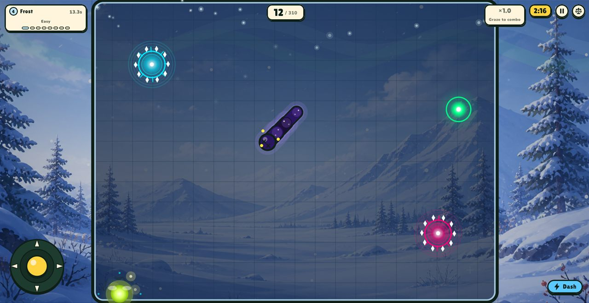<br><sub><b>Desktop</b> · Crystal Tundra: you are the orb, the snake is hunting you</sub></td>
    <td width="50%" align="center">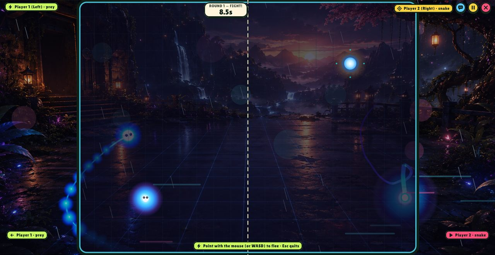<br><sub><b>Desktop</b> · Pass and play: a 1v1 duel on one screen</sub></td>
  </tr>
</table>
<table>
  <tr>
    <td width="33%" align="center">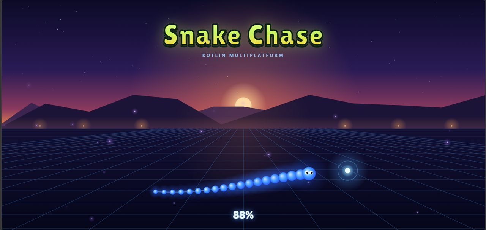<br><sub><b>Web</b> · Loading: the snake grows as the game loads</sub></td>
    <td width="33%" align="center">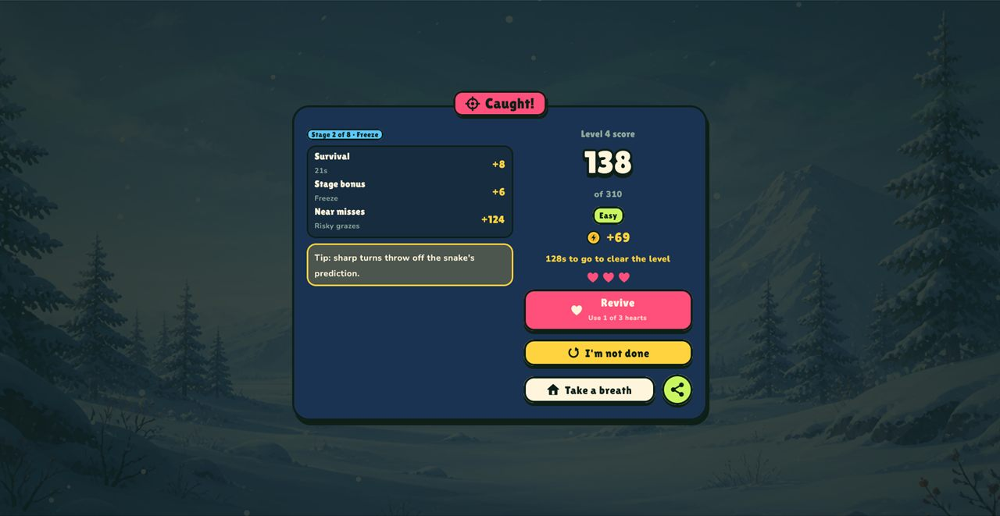<br><sub><b>Desktop</b> · Caught: score, stars and a heart to revive</sub></td>
    <td width="33%" align="center">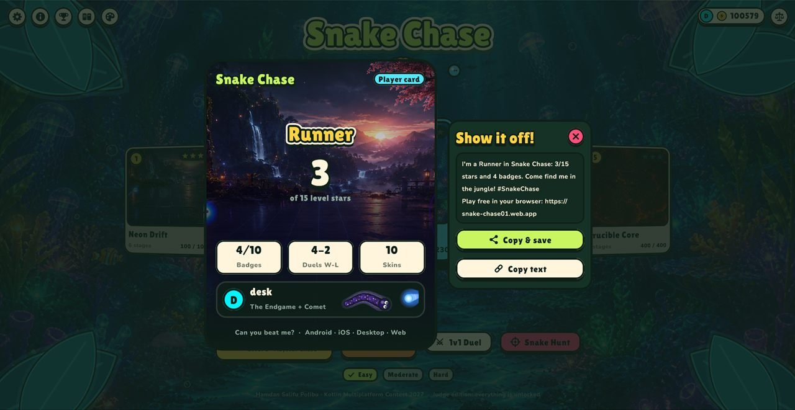<br><sub><b>Desktop</b> · Share card: your result over the world's art</sub></td>
  </tr>
</table>

🎥 **Video demo:** _link added at submission_

---

## The story

Snake Chase started on my dad's Nokia "yam phone", as we call it in Ghana. I lost my dad when I
was 13, and that game is one of the memories I still have of him. Snake was the first phone game
for millions of people, and I wanted to bring it back on the devices we use today. So I turned it around: you are the food. Built with Kotlin Multiplatform and Compose
Multiplatform by **Hamdan Salifu Polibu**, University of Mines and Technology, Ghana.
[Read the full essay →](docs/ESSAY.md) · [How it was built, step by step →](docs/DEVLOG.md)

## One codebase, three platforms

About **95% of the app's code is shared Kotlin** in `commonMain`: the game engine, the AI, every screen,
the online duels, scoring, skins, sound logic and the leaderboard. Each platform adds only a thin
layer:

| Platform | How it runs | Platform-specific code |
| --- | --- | --- |
| **Web** | Kotlin/Wasm in any modern browser | ~270 lines: Web Audio, Web Share |
| **Android** | Native app (API 26+) | ~300 lines: SoundPool, vibration, share sheet |
| **Desktop** | JVM app for Windows, macOS, Linux | ~300 lines: Java Sound, window, clipboard sharing |
| **iOS** | Shared code compiles for iOS in CI | not one of the submitted platforms; not run on a device |

**The same game on every screen:** web, desktop and Android, from one codebase.

<table>
  <tr>
    <td width="33%" align="center">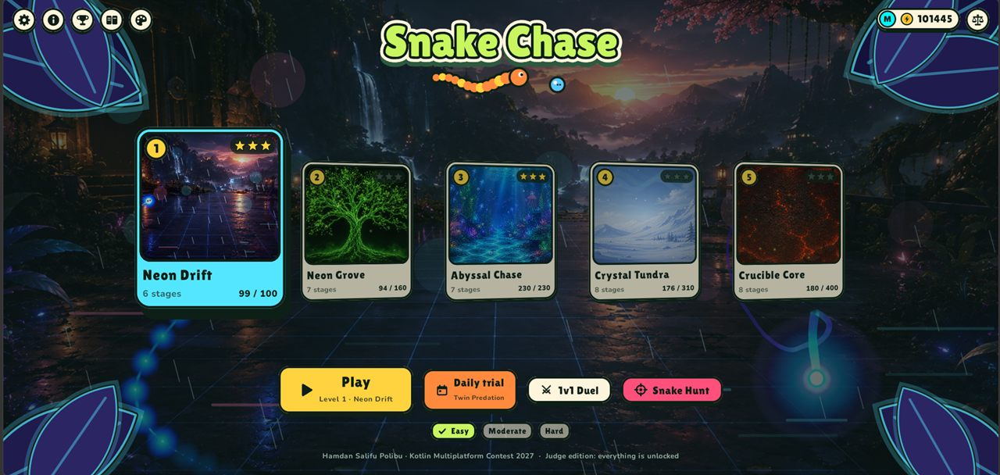<br><sub><b>Web</b> · Kotlin/Wasm in the browser</sub></td>
    <td width="33%" align="center">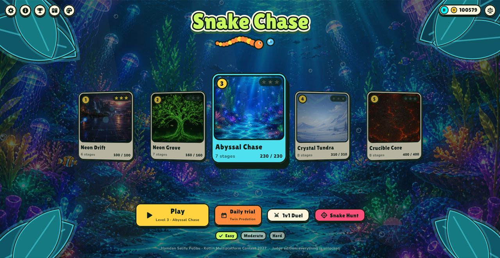<br><sub><b>Desktop</b> · JVM app on Windows</sub></td>
    <td width="33%" align="center">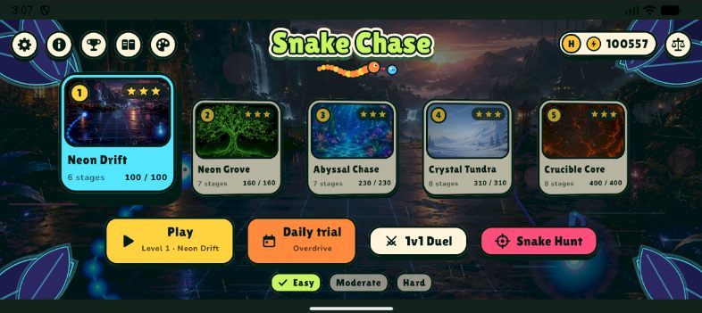<br><sub><b>Android</b> · native app on a phone</sub></td>
  </tr>
</table>

---

## Judge's walkthrough (about 10 minutes)

This build is the **judge edition**: every level, skin and hunt is unlocked and the wallet is full,
on every platform.

<table>
  <tr>
    <td width="50%" align="center">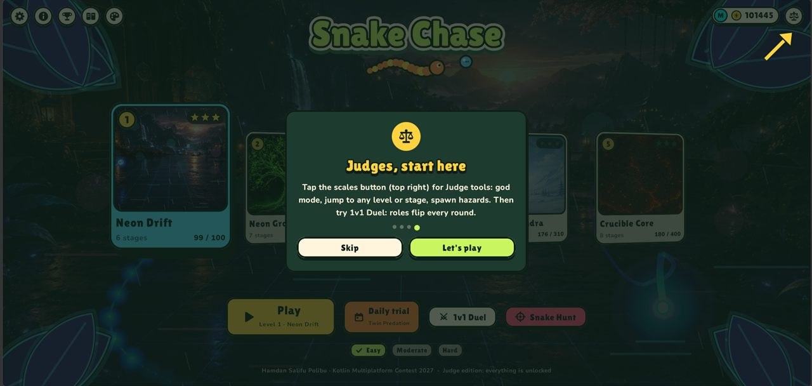<br><sub><b>Web</b> · The welcome tour points judges to their tools</sub></td>
    <td width="50%" align="center">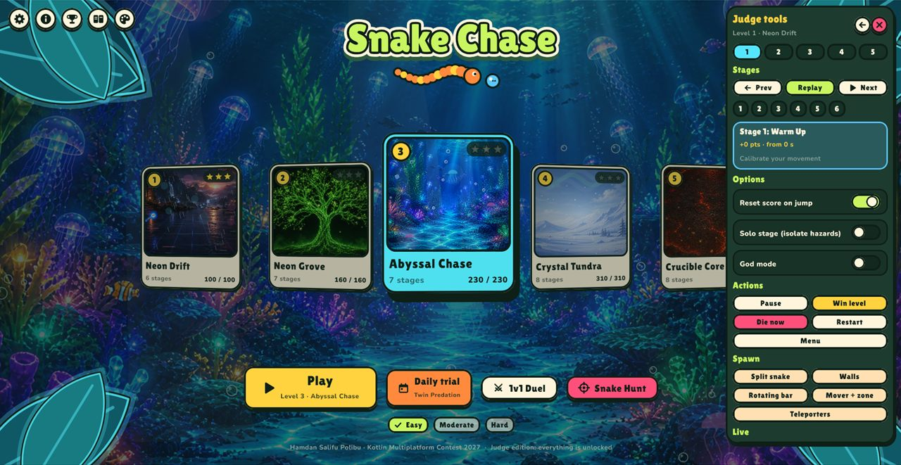<br><sub><b>Desktop</b> · Judge tools: any world or stage, god mode, win a level</sub></td>
  </tr>
</table>

1. **First look (web, 1 minute).** Open https://snake-chase01.web.app. A short welcome tour explains
   the game and points to the **judge tools** (the scales icon, top-right). Your first run pauses
   on one tip card, then the 3-2-1-GO starts.
   *KMP:* the same Compose UI and engine you will see on Android and desktop, compiled to WebAssembly.
2. **Play a world.** Pick a world, press **Play**. The orb simply follows your pointer: the mouse,
   your finger, the keyboard (WASD / arrows) or an on-screen thumbstick. Graze past the snake for
   points: the closer the call, the bigger the score. If it catches you, watch the slow-motion
   replay, then **Revive** with a heart.
   *KMP:* `GameEngine.tick(state, input, dt)` is one pure function shared by every platform.
3. **See all 36 stages fast.** Open the **judge tools**: turn on god mode, jump to any world and
   stage, or **Win level** to skip ahead. Try *Abyssal Chase* (whirlpools), *Crucible Core* (lava
   cracks) and *Crystal Tundra, stage 7* (frostlings, snow whirls, icicles, thin ice).
4. **Change your look.** Open the skin shop (palette icon), pick a snake on **Snakes** and an orb on
   **Orbs**, then start a stage to see them in play.
5. **Settings (gear icon).** Touch drag or joystick, left or right thumb, music and sound volume,
   vibration, difficulty, particle quality and meme roasts. Best tried on a phone.
6. **Duel across devices (the highlight).** On one device: **1v1 Duel → Friend invite → Host**. On
   another (phone, browser or desktop): **Join** with the room code. You get a synced 3-2-1, three
   rounds with roles flipping (the hunter becomes the hunted), pause (10 seconds to come back),
   quick chat and rematch. Afterwards, **Share** your result.
   *KMP:* one networking stack in common code (Ktor + Firebase over REST and server-sent events).
7. **Watch a duel.** With three or more people, two play and everyone else joins with the same code:
   **Friend invite → Join tab → Watch**. You see the match live; the players see "1 watching".
8. **Play against the AI.** **1v1 Duel → Vs AI rival**: you take turns as snake and orb against the
   Wanderer (Easy), the Hunter (Moderate) or the Ghost (Hard, faster and predicts your moves). Then
   try **Snake Hunt** from the home screen, where you are the snake. Both work offline.
9. **No internet? Still a duel.** On Android or desktop, with the same Wi-Fi and no internet:
   **Friend invite → Nearby**. One device hosts and shows its local IP address; the other joins with
   that address. It runs through an embedded Ktor WebSocket server.
10. **Profile and Hall of Fame.** The trophy icon shows your bests with each level's world record,
    and the world top 25 from Firebase, with real players.

---

## Features

**Single player**
- **5 worlds, 36 stages**: Neon Drift, Neon Grove, Abyssal Chase, Crystal Tundra and Crucible Core,
  each with its own hazards, creatures and music ([world identity rule](docs/WORLD_IDENTITY.md)).
- **Easy / Moderate / Hard**: Easy has slower, less predictive snakes, fewer obstacles, a shield at
  every stage and one rescue per stage. Scoring is identical; the world leaderboard counts Moderate
  and Hard.
- **Hearts**: 3 revives that continue a run from just before the catch. Empty hearts come back
  over time, or with coins earned in play.
- **Power-ups**: invincible shield, speed burst, score magnet, ghost walk, plus a dash.
- **Slow-motion catch replay**: the camera pushes in on the bite, with sound and vibration.
- **Daily trial**: one shared seed a day with a twist.
- **Snake Hunt**: you are the snake; catch an AI orb before its clock runs out. Works offline.

**1v1 Duels**: 3 rounds, roles flip every round, the longest survival wins

| Mode | How it connects |
| --- | --- |
| **Vs AI rival** | Offline, on your device. Three AI personalities (the Wanderer, the Hunter, the Ghost). |
| **Friend invite, online** | A room code, played across phone, browser and desktop through Firebase. |
| **Friend invite, Nearby** | Same Wi-Fi, no internet: an embedded Ktor server on Android or desktop. |
| **Pass and play** | One screen, two players: left half against right half. |
| **Online arena** | Quick match against a live stranger, or a ghost duel against a real player's recorded run, with coin stakes per world. |

<table>
  <tr>
    <td width="50%" align="center">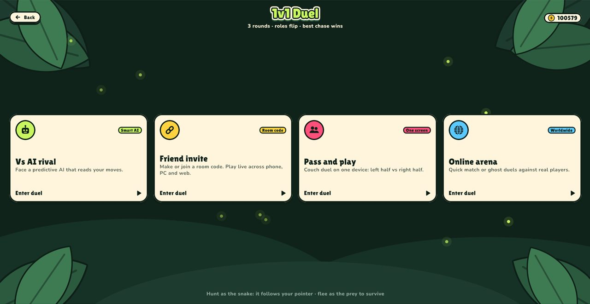<br><sub><b>Desktop</b> · The four duel modes</sub></td>
    <td width="50%" align="center">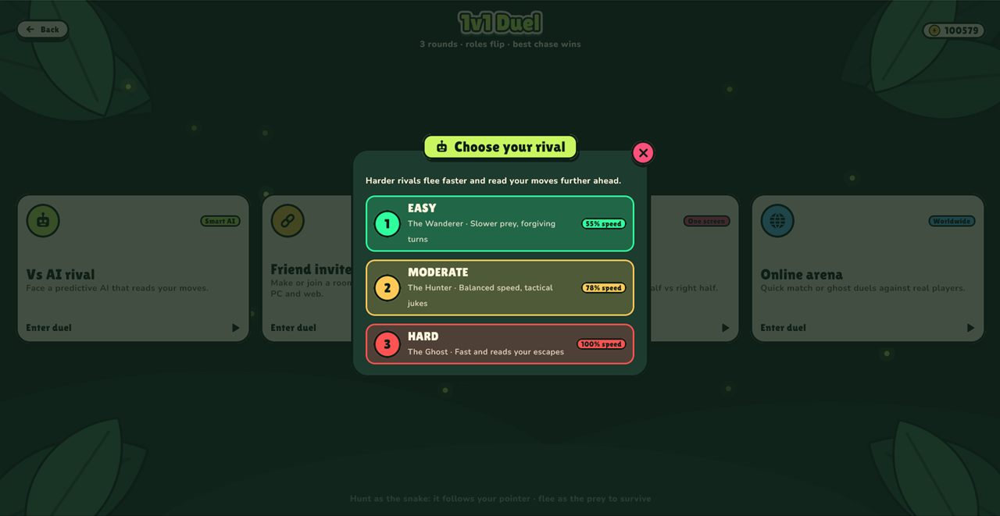<br><sub><b>Desktop</b> · Vs AI: the Wanderer, the Hunter or the Ghost</sub></td>
  </tr>
  <tr>
    <td width="50%" align="center">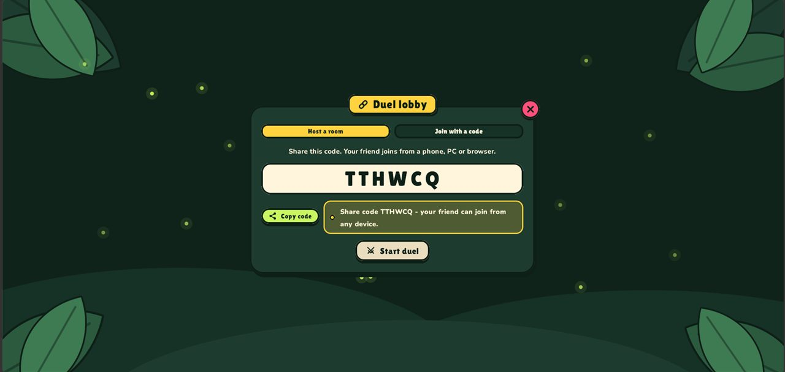<br><sub><b>Web</b> · Friend invite: host a room and share the code</sub></td>
    <td width="50%" align="center">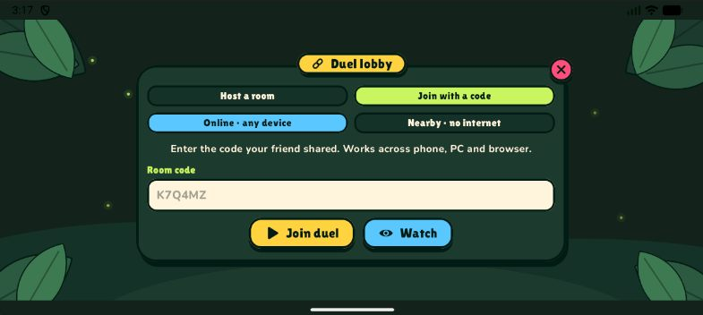<br><sub><b>Android</b> · Join that room with the code, or watch it</sub></td>
  </tr>
  <tr>
    <td width="50%" align="center">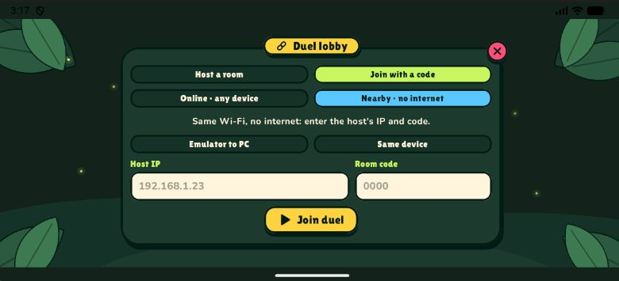<br><sub><b>Android</b> · Nearby: no internet, same Wi-Fi, join by IP</sub></td>
    <td width="50%" align="center">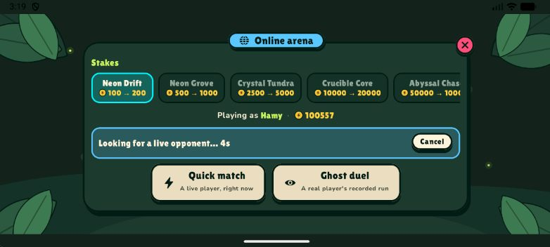<br><sub><b>Android</b> · Online arena: quick match or ghost duel</sub></td>
  </tr>
</table>

Every live duel has a synced countdown, pause with a 10-second return window, quick chat, rematch,
**spectators** (watch any room by its code), both players' real skins, and share cards.

**Progress and polish**
- Stars per level, 13 snake skins and 11 orb skins (bought, or earned by feats), each with its own
  animated effect (for example fireflies around an orb, or a glowing snake) and 1-5 ratings: orbs
  for **Speed / Dash / Graze**, snakes for **Speed / Agility / Reach**. Skins give at most a small
  edge, and never in live online duels. Both players see each other's real skins online.
- Player card with ranks and badges. **Share cards** for every result: your score drawn over the
  world's painted background, with a link that opens the game in a browser so friends can play you
  back.
- **Welcome tour** on first open, and one tip card before your first run (it shows the controls for
  your device), so new players and judges know where everything is.
- Per-world music and original sound effects ([credits](docs/CREDITS.md)), haptics, screen shake,
  and optional meme roasts after every third loss.
- Controls for everyone: mouse, touch, keyboard, or an on-screen thumbstick on the left or right
  thumb, for left- and right-handed players, in every mode (levels, Vs AI, online and friend duels).
- Settings: music and sound volumes, vibration, difficulty, Ultra particles or battery saver, meme
  roasts on or off, and a full progress reset.
- Offline-aware: an offline banner, online modes clearly marked, and results queued for upload.

<table>
  <tr>
    <td width="50%" align="center">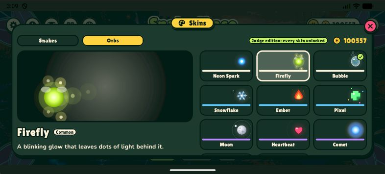<br><sub><b>Android</b> · Orb skins: Speed / Dash / Graze</sub></td>
    <td width="50%" align="center">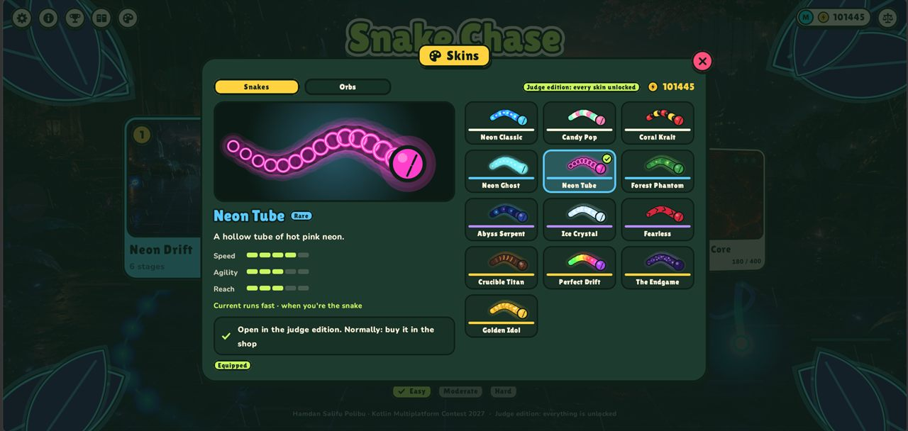<br><sub><b>Web</b> · Snake skins: Speed / Agility / Reach</sub></td>
  </tr>
</table>
<table>
  <tr>
    <td width="33%" align="center">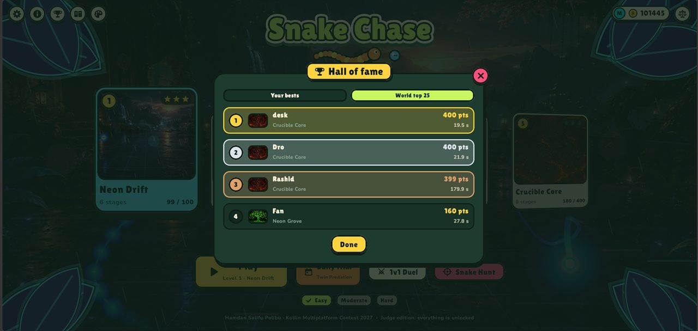<br><sub><b>Web</b> · Hall of Fame: live world top 25</sub></td>
    <td width="33%" align="center">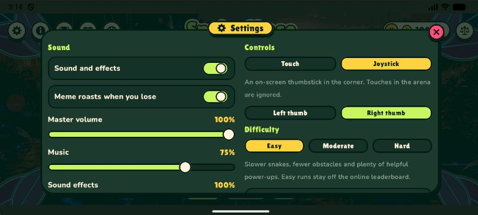<br><sub><b>Android</b> · Settings: joystick on either thumb</sub></td>
    <td width="33%" align="center">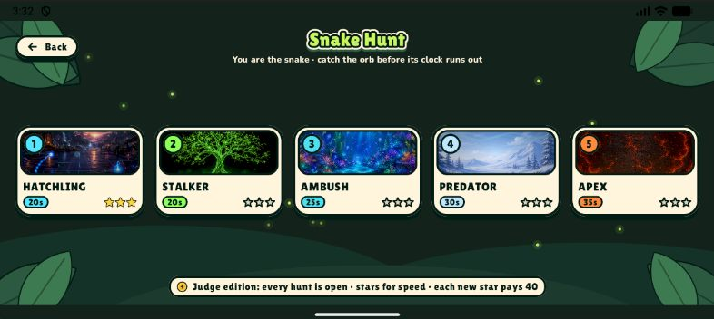<br><sub><b>Android</b> · Snake Hunt: you are the snake</sub></td>
  </tr>
</table>

<details>
<summary><b>More screenshots</b></summary>
<br>
<table>
  <tr>
    <td width="50%" align="center">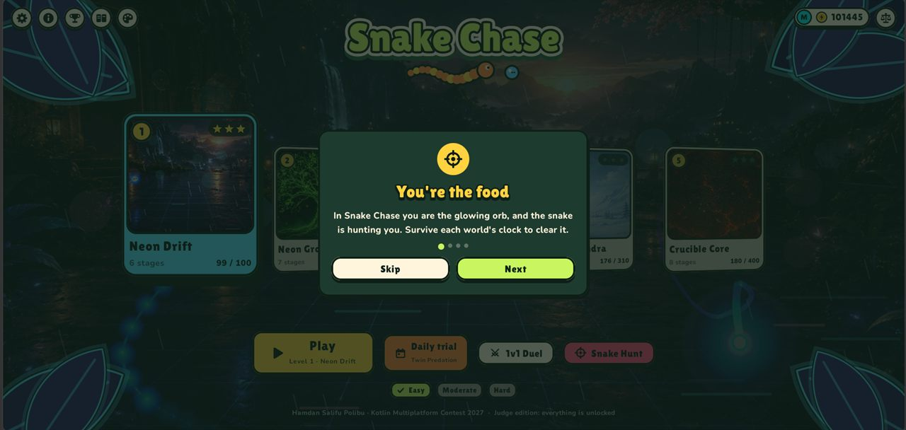<br><sub><b>Web</b> · Welcome tour: you're the food</sub></td>
    <td width="50%" align="center">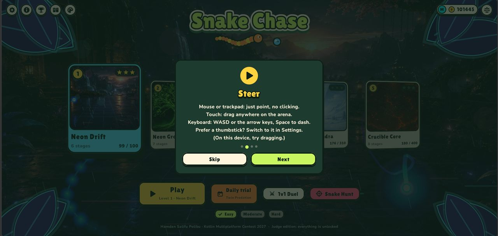<br><sub><b>Web</b> · Welcome tour: how to steer</sub></td>
  </tr>
  <tr>
    <td width="50%" align="center">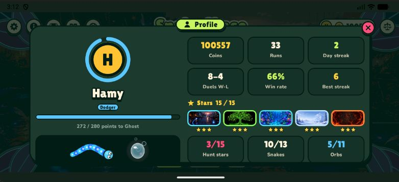<br><sub><b>Android</b> · Player card: coins, duel record, badges</sub></td>
    <td width="50%" align="center">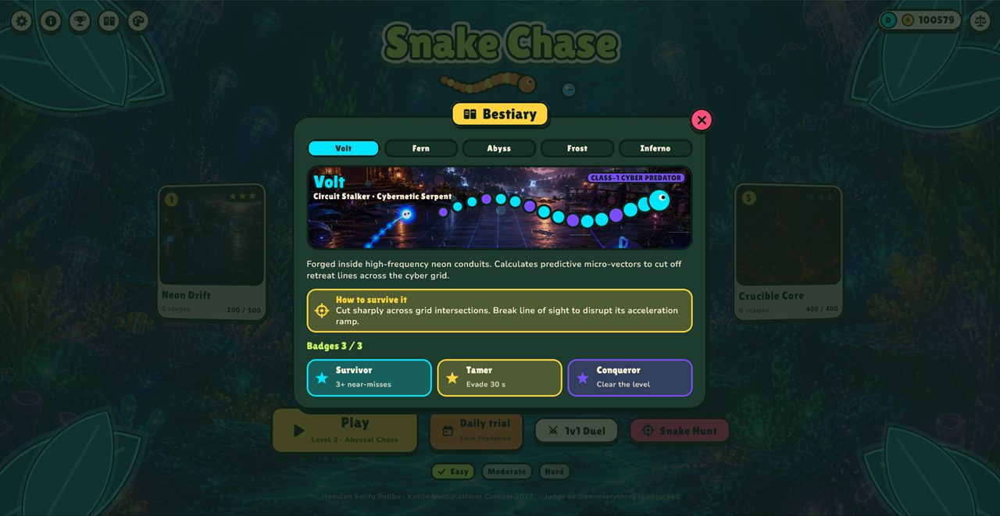<br><sub><b>Desktop</b> · Bestiary: each world's snakes and how to survive them</sub></td>
  </tr>
  <tr>
    <td width="50%" align="center">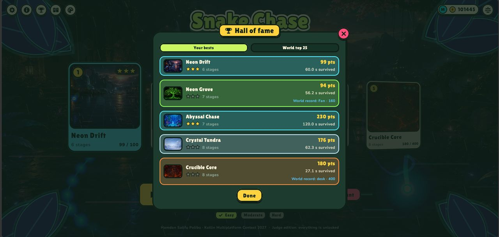<br><sub><b>Web</b> · Your bests next to each level's world record</sub></td>
    <td width="50%" align="center">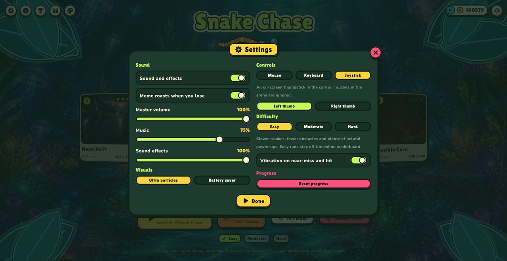<br><sub><b>Desktop</b> · Settings: mouse, keyboard or joystick</sub></td>
  </tr>
</table>
</details>

---

## How players connect

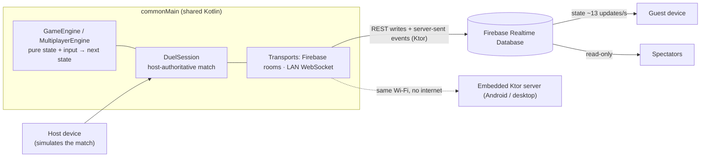

- **Online:** no game server. The host simulates; game state and the guest's input travel through
  Firebase Realtime Database as plain REST writes and server-sent events, using Ktor on every
  platform. Several writes stay in flight at once (about 13 updates a second), and the receiver
  drops anything that arrives out of order.
- **Resilient:** sign-in is refreshed automatically when it expires, room creation retries, and a
  peer that disappears is detected by heartbeat.
- **Offline:** single-player always works. On Android and desktop, Nearby duels run over the local
  Wi-Fi through an embedded Ktor WebSocket server. Scores made offline upload later.

## Run it

Requirements: **JDK 21** and the Android SDK for Android. Everything else comes through the Gradle
wrapper.

| Platform | Command |
| --- | --- |
| Web (dev server, opens the browser) | `./gradlew :composeApp:wasmJsBrowserDevelopmentRun` |
| Desktop (Windows / macOS / Linux) | `./gradlew :composeApp:run` |
| Android (emulator or device) | `./gradlew :composeApp:installDebug` |
| Web (production bundle) | `./gradlew :composeApp:wasmJsBrowserDistribution` → `composeApp/build/dist/wasmJs/productionExecutable` |
| Tests | `./gradlew :composeApp:desktopTest` and `./gradlew ktlintCheck` |

On Windows use `gradlew.bat`. Ready-made builds (Android APK, desktop app) are attached to the
[Releases](../../releases) page.

## How it is built

```
composeApp/src/
  commonMain/        the whole game, shared by every platform
    engine/          GameEngine (pure tick), SnakeAI, MultiplayerEngine, Vortex, Solid,
                     PowerUpSystem, ScoringEngine
    levels/          5 world definitions, scoring budget, stars
    presentation/    GameViewModel + GameIntent (unidirectional state flow)
    network/         DuelSession, Firebase Realtime Database + LAN transports, quick match
    online/          leaderboard, ghost duels, offline upload queue
    profile/         profile, hearts, player card
    ui/              Compose screens, canvas renderers, the "Jungle Arcade" design kit
    platform/        expect declarations: audio, haptics, sharing, sound bank
  androidMain/ desktopMain/ wasmJsMain/ iosMain/   small `actual` implementations
  jvmAndAndroidMain/                               the embedded LAN duel server (Ktor)
  commonTest/ desktopTest/                         139 tests
```

- **A pure engine.** The engine never mutates state; it returns the next immutable `GameState`. That
  makes whole runs, duels and the real ViewModel testable frame by frame on any platform.
- **`expect`/`actual` only at the edges:** audio, haptics, sharing and the LAN server.
- **Kotlin conventions** are enforced by ktlint (IntelliJ Kotlin style) in CI.

Tech: Kotlin 2.1 · Compose Multiplatform 1.7 · Kotlin/Wasm · Koin · Ktor · kotlinx.serialization ·
kotlinx.datetime · multiplatform-settings · Firebase (Auth, Firestore, Realtime Database, Hosting)
over REST · ktlint. More detail: [architecture](docs/ARCHITECTURE.md),
[technical decisions](docs/TECH_DECISIONS.md).

## Troubleshooting

- **The web page stays on the loader:** the game needs a browser with WebAssembly GC (current
  Chrome, Edge, Firefox, or Safari 18.2+).
- **A duel won't connect:** both devices need internet for online rooms. With no internet, use
  **Nearby** on Android or desktop, on the same Wi-Fi.
- **Android emulator says "offline" after your computer reconnects:** the emulator's network can
  get stuck after the host's connection drops; restart the emulator.

## Credits & licence

Created by **Hamdan Salifu Polibu** for the Kotlin Multiplatform Contest.
Music and sound credits (all CC0 third-party audio): [docs/CREDITS.md](docs/CREDITS.md).
Licensed under the [Apache License 2.0](LICENSE).
